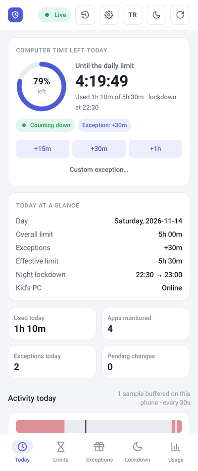
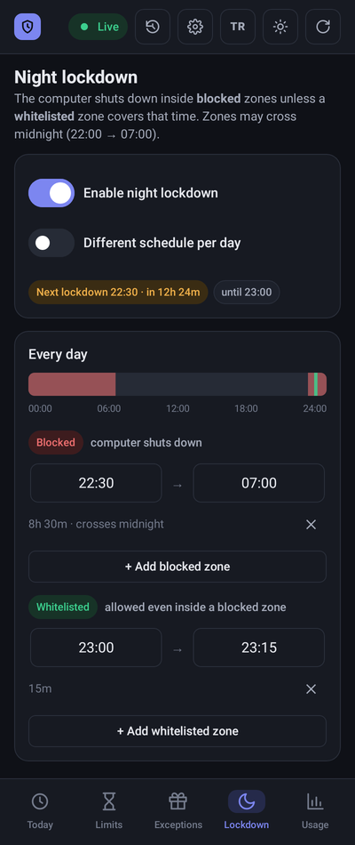
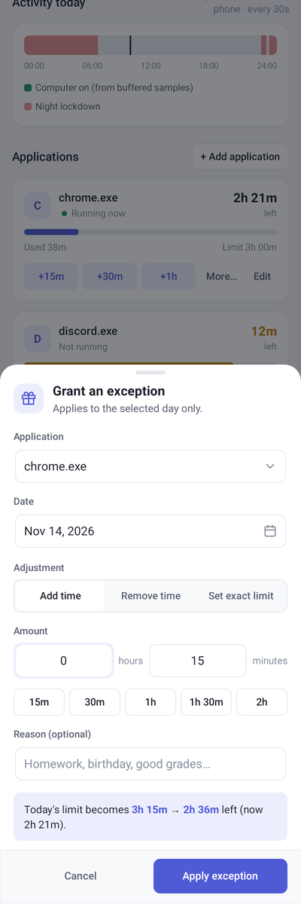
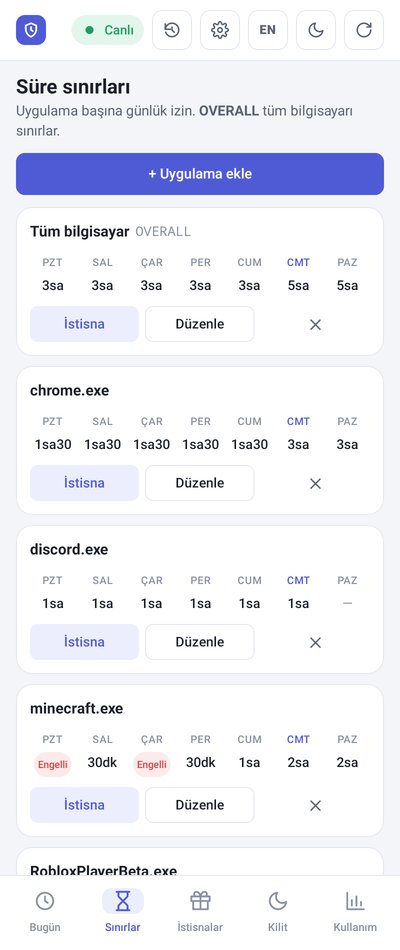

# PCV2 for Android

A native Android app for [PCV2 – Parental Controls V2](https://github.com/MelihAydinYanibol/PCV2).
It talks to the same server as the web dashboard (`serverside/secondary_api.py`) and
mirrors the dashboard's phone layout: same sections, colours, icons, texts (English /
Turkish) and behaviour, built with Jetpack Compose.

| Today | Night lockdown (dark) | Exception sheet | Limits (Türkçe) |
|---|---|---|---|
|  |  |  |  |

## Features

Everything the web dashboard does, using the same API calls:

- **Sign in** with the dashboard password (same `POST /login` form, `pcv2_session` cookie,
  lockout messages) or with `DASHBOARD_API_TOKEN` as a Bearer token. When a session
  expires the app returns to the sign-in screen.
- **Today**: live countdown of computer time left (overall limit, every exception and the
  next night lockdown), progress ring, "Counting down" / "Paused · PC offline" chips,
  one-tap **+15m / +30m / +1h**, at-a-glance panel, stats, activity timeline from
  buffered samples, per-app cards with time left (capped by the computer's own time),
  running/not-running state and "used without a limit".
- **Time limits**: per-day limits for every app and `OVERALL`, add / edit / delete,
  "No limit" days, copy Monday to all days / weekdays, queued edits marked.
- **Exceptions**: add time, remove time or set an exact limit for any date, with a live
  preview of the new limit; per-transaction delete, delete all, result per app.
- **Night lockdown**: enable, per-day schedules, blocked / whitelisted zones with time
  pickers, zones across midnight, timeline preview, "active now / next lockdown" status,
  copy to all days, unsaved-changes save bar, warning when saving would start a lockdown.
- **Usage**: last 7 days chart (tap a bar to open that day) and per-app usage for any date.
- **Pending changes**: changes made while the kid's PC is off are queued by the server;
  see them, cancel one, sync now or clear all.
- **Settings**: server address, refresh / sample intervals, theme (system / light /
  dark), language, app buffer (download / clear), sign out, and download / upload of the
  full configuration JSON.
- **Offline**: the latest data and usage samples are kept on the phone. When the kid's PC
  is off you see the server's cached data with "last seen"; if the server itself is
  unreachable the app shows the phone's buffer. The app paints instantly from the buffer
  on start.
- Mobile comforts: bottom navigation, dialogs as bottom sheets (swipe down to close),
  pull to refresh, swipeable toasts, back button steps back through tabs, light/dark
  status bar, edge-to-edge, Android password autofill.

## Install

Download the APK from the latest
[GitHub Actions run](../../actions/workflows/android.yml) (artifact `pcv2-apk-…`) or from
[Releases](../../releases) for tagged versions, then open it on the phone and allow
"Install unknown apps" for your browser / file manager.

On first start enter the server address, e.g. `http://192.168.1.10:5035` (the same address
you open the web dashboard with) and the dashboard password.

> Plain `http://` is allowed because PCV2 usually runs on the home network. If you expose
> the server to the internet, put it behind HTTPS as the PCV2 README describes.

## Mock server

`mock-server/mock_server.py` is a self-contained stand-in for `secondary_api.py` +
`auth.py` with a simulated kid's PC, so every feature can be tried without Windows:

```bash
cd mock-server
pip install -r requirements.txt
python mock_server.py                          # http://0.0.0.0:5035, password: parent1234
```

- Same endpoints, validation, status codes and messages as the real server, including
  the sign-in form, sessions, lockout after 5 wrong passwords, Bearer tokens
  (`--token my-token`), the offline cache (`cached: true`) and the request queue (`202`).
- Usage counts up every second for "running" apps, apps stop counting when their limit is
  reached, and the PC "shuts down" when the overall time is up or a lockdown is active.
- **Control panel at `http://<host>:5035/mock`**: switch the kid's PC on/off, start/stop
  apps, speed up the clock, add usage, add latency, make the server fail (HTTP 500 or a
  wrong primary token), expire all sign-ins, disable sign-in, and load scenarios (time
  almost up, lockdown now / in 10 min, empty config, queued changes, reset).
- `--offline` starts with the PC off, `--empty` with no configuration, `--no-auth` without
  sign-in, `--web-dir ../../PCV2/serverside` also serves the real web dashboard at `/`, so
  you can compare the app and the website side by side.

From the Android emulator the host machine is `http://10.0.2.2:5035`; from a phone use
your computer's LAN address.

## Build

Requirements: JDK 17+ and the Android SDK (platform 35).

```bash
./gradlew assembleDebug        # app/build/outputs/apk/debug/app-debug.apk
./gradlew assembleRelease      # minified, signed with the debug key unless a keystore is set
```

Tests:

```bash
./gradlew testDebugUnitTest    # logic tests only
```

With the mock server running (`python mock_server.py --token test-token`), the same
command also runs the API integration tests and the Robolectric UI tests, which sign in,
drive every screen and save screenshots (light/dark, English/Turkish) to
`app/build/screenshots`:

```bash
PCV2_MOCK_URL=http://127.0.0.1:5035 ./gradlew testDebugUnitTest
```

## GitHub Actions

`.github/workflows/android.yml` runs on every push, pull request and manually:

1. tests the mock server (`pytest`) and starts it,
2. runs the unit, API and UI tests against it,
3. builds the debug and release APKs and uploads them (plus the screenshots) as artifacts,
4. on a `v*` tag (e.g. `git tag v1.0.0 && git push --tags`) attaches the APK to a GitHub release.

The release APK is signed with the debug key unless these repository secrets are set:

| Secret | Value |
|---|---|
| `PCV2_KEYSTORE_BASE64` | `base64 -w0 release.jks` |
| `PCV2_KEYSTORE_PASSWORD` | keystore password |
| `PCV2_KEY_ALIAS` | key alias |
| `PCV2_KEY_PASSWORD` | key password |

Create a keystore once with
`keytool -genkeypair -v -keystore release.jks -keyalg RSA -keysize 4096 -validity 10000 -alias pcv2`.
Keep using the same key, otherwise Android refuses to update the installed app.

## Project layout

```
app/src/main/java/com/pcv2/app/
  core/   Models (API payloads), Logic (limit / lockdown maths, formatting — ported
          from dashboard.html and the engines), I18n (TR table generated from dashboard.html)
  data/   ApiClient (secondary API + /login), Store (settings, on-phone buffer)
  ui/     AppViewModel (state, polling, mutations) and the Compose screens
mock-server/   mock_server.py + its tests
```

## License

GPL-3.0, like PCV2.
